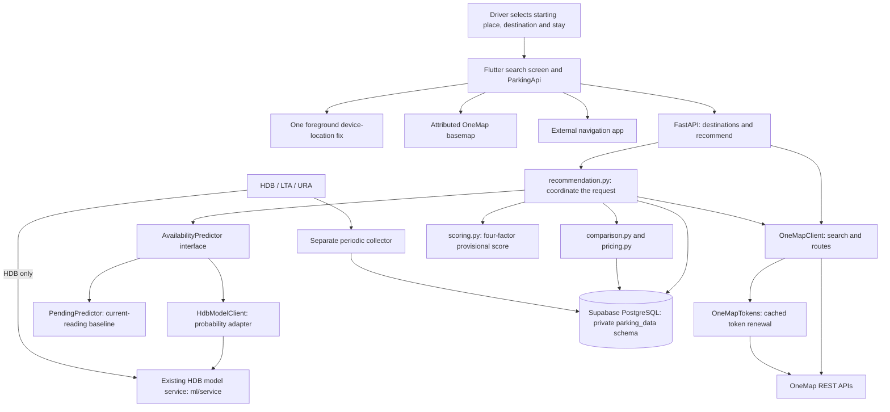

# ParkChoiceSG architecture — working prototype

Updated 26 October 2026. This describes the implemented search backend and its
connected Flutter search screen. It is the backend portion of the team's design,
not a claim that operator workflows and all-provider forecasting are complete.

## Small, explainable structure

The request-time Python modules live in `backend/`; collection helpers remain in `data-pipeline/`. There is one HTTP entry
point, one recommendation control class and small routing, pricing, prediction and scoring
modules. The supplied ML inference service runs separately on localhost port
8001; the app backend calls it through one small HTTP adapter. No ORM, message
broker or dependency-injection container is introduced. The existing collectors run as a
separate command; searching does not start collection or retrain a model.

| File/class | Responsibility |
|---|---|
| `app.py` | Validate HTTP input, call the workflow and return JSON/safe errors. Selects the configured model client or explicit current baseline. |
| `RecommendationController`, `TripRequest`, `recommendation.py` | Shortlist, route, price, predict and coordinate ranking. The public function delegates to the control class. |
| `OneMapClient` / `RoutingProvider` | Normalize destination search and route measurements; replaceable in tests. |
| `OneMapTokens` | HTTPS REST authentication, expiry-based memory cache and one retry after rejection. Credentials never enter Flutter. |
| `CandidateStay`, `comparison.py` | Load applicable tariff versions and quote options from one DB snapshot. |
| `PriceQuote`, `pricing.py` | Apply approved day/time/payment/grace/tier/cap rules. Missing or ambiguous rules remain unquoted. |
| `PredictionRequest`, `Prediction`, `AvailabilityPredictor` | Small contract for the trained model. Validate identity, target time, model version, confidence and recent history cutoff. |
| `PendingPredictor` | Return pending status with no invented forecast or confidence. |
| `HdbModelClient` | Call the HDB inference service; validate probability, identity, actual issue time and recent history. Restrict the shortlist to HDB and the integration to short-mode horizons of 15–90 minutes. |
| `scoring.py` | Calculate the provisional score and deterministic tie-breaks from eligible raw factors. |
| Flutter `ParkingApi` | POST destination/search requests to the backend and handle unavailable-service responses. |
| Flutter `CarparkSearchScreen` | Let the driver select both locations and duration; show real costs, route measurements and correctly labelled availability. |

The useful design patterns are Adapter (OneMap normalization) and Strategy (the
replaceable predictor). There is no separate generic repository layer: the few
read-only queries live next to the workflow that uses them.

## Request lifecycle

1. The driver searches and selects a starting location and destination. The
   driver may alternatively request one current-device fix. Old fixes require
   refresh; permission denial retains manual selection. It opens anonymously.
2. The backend reads a bounded nearby shortlist from cleaned canonical locations.
   Straight-line distance is used only for this shortlist, never displayed as a
   walking route. Current baseline mode requires fresh source-timestamped,
   positive readings. Both modes exclude loading bays, no-short-term facilities,
   ambiguous geometry and identities without a reviewed calculator.
3. OneMap returns driving routes to each carpark and walking routes from it to
   the destination. The workflow uses a common departure instant after all route
   responses, retaining the measurement timestamps and unconfirmed traffic basis.
4. The pricing step quotes neighbouring whole-minute arrivals. Both quotes must
   use supported matching payment/schedule rules; otherwise the price is withheld.
   When amounts differ, both are displayed and the higher estimate is scored.
   Exact-second billing and a guaranteed real-charge bound are not asserted.
5. The pending-model mode uses only the clearly labelled current-count baseline.
   A ready adapter switches the whole request to prediction basis, with no silent
   mixing. Invalid, missing, low-confidence, stale-history or over-capacity
   forecasts are excluded with reasons. The integrated classifier predicts
   `p_free`, not lots, uses `1-p_free` as the availability penalty, and requires
   probability at least 0.90. A currently full carpark can qualify if its future
   probability passes. Model fallback profiles, URA and LTA are not silently
   included in that HDB ranking.
   If no forecast ranks, eligible fresh source readings can form a separate
   current-only list. The ML service shares cached HDB counts through `/current`;
   those do not require another database collector. Known low probabilities are
   not promoted through fallback, and historical probabilities remain excluded.
6. Eligible candidates receive the provisional four-factor score and a stable
   order. The response retains factors, exclusions, quote evidence and the score
   trace. The client displays a genuine unavailable state when nothing qualifies.
7. The client can show an attributed OneMap basemap with selected locations and
   carpark markers, then explicitly hand off navigation to an external app/browser.
   No paid Google routing API is called and no background location tracking is used.

## Persistence, access and practical limits

Existing `parking_data` tables store identities, availability history, metadata
and tariff evidence. No new database objects were needed for this workflow.
Private `.env` values and provider responses remain ignored. Search requests,
driver accounts and personal origins are not persisted. The prototype's logs
omit HTTP access logs; validation error responses do not echo submitted values.

Read-only repeatable-read transactions hold DB snapshots for a short read stage,
then close before network routing. Collection runs write transactions separately. The
prototype currently uses the configured database credential with a read-only
transaction; a dedicated least-privilege DB login still needs provisioning before
deployment. Localhost API setup is not a deployed public service. Operator credential verification
and a client-side console entry gate are implemented; server-side administration
sessions and authorization remain unfinished. OneMap attribution is visible; a production privacy
notice and deployment controls remain release work.

The active Flutter source is `parkchoice_flutter/`. The older copy under `lab 3/`
is retained only as an earlier academic artifact.
Tracker, preferences and operator screens remain existing prototype work and are
not evidence that their backend use cases have been implemented.

See [BACKEND-RUNBOOK.md](BACKEND-RUNBOOK.md),
[SCORING-VALIDATION.md](validation/SCORING-VALIDATION.md) and [MODEL-INTEGRATION.md](MODEL-INTEGRATION.md).
