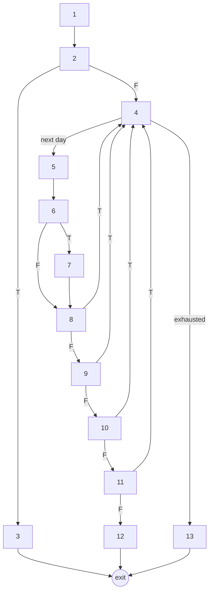
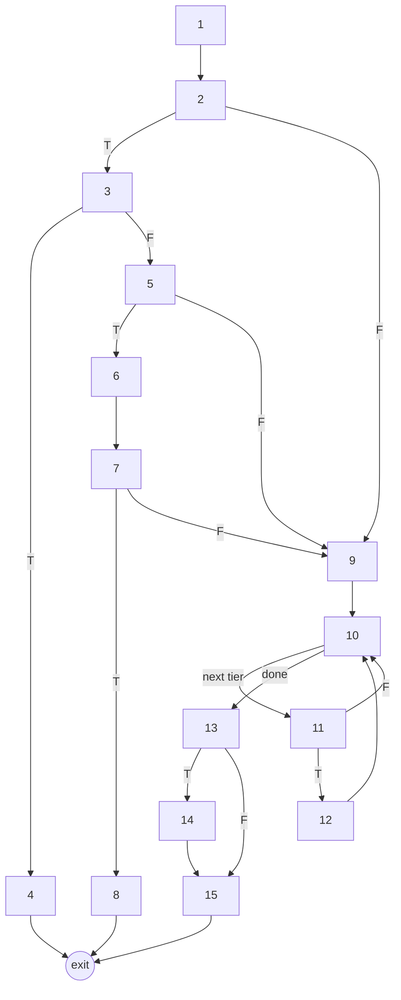

# Lab 4 test cases and results

This is the supplementary scoring and pricing-path study for Lab 4 procedure 3.2. The primary concrete control-class cases and current results are in `../../lab4/TEST-CASES-AND-RESULTS.md`. Black box tests target `scoring.score_candidate`. Basis path tests target `pricing.window_at` and `pricing._tier_price`. All cases are automated with `unittest`.

| File | Contents |
|---|---|
| `test_lab4_score_candidate.py` | Equivalence class and boundary value cases |
| `test_lab4_basis_path.py` | Basis path cases for both methods |
| `lab4_report.py` | Runs every case and rewrites the results tables below |

Run from `backend/`:

```
python -m unittest discover -s validation -p "test_lab4_*.py" -v
python validation/lab4_report.py
```

## 1. Black box testing of `score_candidate` (3.2.1)

### Why this method

`score_candidate` ranks every carpark recommendation, which is the core requirement of the product (feature group 4.4). It turns cost, walking distance, driving time and predicted availability into one 0 to 100 score. A wrong score puts the wrong carpark first, so this logic needs the most careful input testing.

### Specification under test

Each factor becomes a penalty between 0 and 1. The score is `100 × (1 − Σ weight × penalty)`.

| Factor | Penalty | Penalty is 0.5 when |
|---|---|---|
| Cost | cost ÷ (cost + 400 × duration ÷ 60) | cost is S$4 per hour of stay |
| Walking | metres ÷ (metres + 500) | 500 m |
| Driving | seconds ÷ (seconds + 900) | 15 min |
| Availability, lots mode | 1 ÷ (1 + lots) | 1 lot |
| Availability, probability mode | 1 − p_free | p_free = 0.5 |

Default weights are cost 0.40, walking 0.30, availability 0.20 and driving 0.10. Invalid input raises `ValueError`.

The nominal input is cost 400 cents, duration 60 min, walking 500 m, driving 900 s and 1 lot. Every penalty is then 0.5, so the score is exactly 50. Each test changes the nominal input, which keeps the expected output easy to check by hand.

### Equivalence classes

| Input | Valid classes | Invalid classes |
|---|---|---|
| `cost_cents` | V1 integer ≥ 0 | I1 negative integer; I2 not an integer |
| `duration_minutes` | V2 integer ≥ 1 | I3 integer ≤ 0; I4 not an integer |
| `walking_meters` | V3 finite number ≥ 0 | I5 negative; I6 infinite or NaN; I7 not a number |
| `driving_seconds` | V4 finite number ≥ 0 | I8 negative; I9 infinite or NaN |
| Availability | V5 lots ≥ 0 with no probability; V6 probability in [0, 1] with no lots | I10 lots negative; I11 neither supplied; I12 both supplied; I13 probability < 0; I14 probability > 1; I15 probability NaN |
| `weights` | V7 omitted, so defaults apply; V8 four positive weights that sum to 1 | I16 a key missing; I17 a weight ≤ 0; I18 sum is not 1 |

There are 8 valid and 18 invalid classes. Two tests cover all 8 valid classes. Each invalid class gets its own test, so a failure points to one cause.

### Boundary values

Each test moves one input to its boundary and keeps the others nominal.

| Input | Boundary | Values tested | Expected score by hand |
|---|---|---|---|
| Cost | 0 | −1, 0, 1 | error; 100 × (1 − 0.30) = 70; 100 × (1 − 0.4 × 1/401 − 0.30) = 69.9002 |
| Duration | 1 | 0, 1 | error; reference 6.667 cents, cost penalty 0.9836, score 30.6557 |
| Walking | 0 | −0.001, 0 | error; 100 × (1 − 0.35) = 65 |
| Driving | 0 | −0.001, 0 | error; 100 × (1 − 0.45) = 55 |
| Lots | 0 | −0.001, 0 | error; availability penalty 1, score 40 |
| Probability | 0 and 1 | −0.001, 0, 1, 1.001 | error; 40; 60; error |
| Weight sum | 1 | exactly 1, 1.000001 | 50; error |

Duration, walking, driving and lots have no upper limit in this method. The API layer caps duration at 1440 minutes, and `TripRequest` tests cover that cap.

### Results: equivalence classes

<!-- ec:start -->
| ID | Class or boundary | Test input (changes from nominal) | Expected output | Actual output | Result |
|---|---|---|---|---|---|
| EC-01 | Valid lots mode, default weights (V1-V5, V7) | `nominal` | 50.0 (best_overall_v1_provisional) | 50.0 (best_overall_v1_provisional) | Pass |
| EC-02 | Valid probability mode, custom weights (V6, V8) | `available_lots=None, p_free=0.5, weights={'cost': 0.25, 'walking': 0.25, 'availability': 0.25, 'driving': 0.25}` | 50.0 (best_overall_probability_v2_provisional) | 50.0 (best_overall_probability_v2_provisional) | Pass |
| EC-03 | I1 cost negative | `cost_cents=-400` | ValueError | ValueError | Pass |
| EC-04 | I2 cost not an integer | `cost_cents=400.0` | ValueError | ValueError | Pass |
| EC-05 | I3 duration not positive | `duration_minutes=-60` | ValueError | ValueError | Pass |
| EC-06 | I4 duration not an integer | `duration_minutes=60.5` | ValueError | ValueError | Pass |
| EC-07 | I5 walking negative | `walking_meters=-500` | ValueError | ValueError | Pass |
| EC-08 | I6 walking not finite | `walking_meters=inf` | ValueError | ValueError | Pass |
| EC-09 | I7 walking not a number | `walking_meters='500'` | ValueError | ValueError | Pass |
| EC-10 | I8 driving negative | `driving_seconds=-900` | ValueError | ValueError | Pass |
| EC-11 | I9 driving not finite | `driving_seconds=nan` | ValueError | ValueError | Pass |
| EC-12 | I10 lots negative | `available_lots=-5` | ValueError | ValueError | Pass |
| EC-13 | I11 no availability input | `available_lots=None` | ValueError | ValueError | Pass |
| EC-14 | I12 both lots and probability | `p_free=0.5` | ValueError | ValueError | Pass |
| EC-15 | I13 probability below 0 | `available_lots=None, p_free=-0.5` | ValueError | ValueError | Pass |
| EC-16 | I14 probability above 1 | `available_lots=None, p_free=1.5` | ValueError | ValueError | Pass |
| EC-17 | I15 probability NaN | `available_lots=None, p_free=nan` | ValueError | ValueError | Pass |
| EC-18 | I16 weight key missing | `weights={'cost': 0.5, 'walking': 0.3, 'availability': 0.2}` | ValueError | ValueError | Pass |
| EC-19 | I17 weight not positive | `weights={'cost': 0.5, 'walking': 0.5, 'availability': 0.0, 'driving': 0.0}` | ValueError | ValueError | Pass |
| EC-20 | I18 weights do not sum to 1 | `weights={'cost': 0.5, 'walking': 0.5, 'availability': 0.5, 'driving': 0.5}` | ValueError | ValueError | Pass |
<!-- ec:end -->

### Results: boundary values

<!-- bv:start -->
| ID | Class or boundary | Test input (changes from nominal) | Expected output | Actual output | Result |
|---|---|---|---|---|---|
| BV-01 | cost just below 0 | `cost_cents=-1` | ValueError | ValueError | Pass |
| BV-02 | cost at 0 | `cost_cents=0` | 70.0 | 70.0 | Pass |
| BV-03 | cost just above 0 | `cost_cents=1` | 69.9002 | 69.9002 | Pass |
| BV-04 | duration at 0 | `duration_minutes=0` | ValueError | ValueError | Pass |
| BV-05 | duration at 1 | `duration_minutes=1` | 30.6557 | 30.6557 | Pass |
| BV-06 | walking just below 0 | `walking_meters=-0.001` | ValueError | ValueError | Pass |
| BV-07 | walking at 0 | `walking_meters=0` | 65.0 | 65.0 | Pass |
| BV-08 | driving just below 0 | `driving_seconds=-0.001` | ValueError | ValueError | Pass |
| BV-09 | driving at 0 | `driving_seconds=0` | 55.0 | 55.0 | Pass |
| BV-10 | lots just below 0 | `available_lots=-0.001` | ValueError | ValueError | Pass |
| BV-11 | lots at 0 | `available_lots=0` | 40.0 | 40.0 | Pass |
| BV-12 | probability just below 0 | `available_lots=None, p_free=-0.001` | ValueError | ValueError | Pass |
| BV-13 | probability at 0 | `available_lots=None, p_free=0` | 40.0 | 40.0 | Pass |
| BV-14 | probability at 1 | `available_lots=None, p_free=1` | 60.0 | 60.0 | Pass |
| BV-15 | probability just above 1 | `available_lots=None, p_free=1.001` | ValueError | ValueError | Pass |
| BV-16 | weights sum exactly 1 | `weights={'cost': 0.1, 'walking': 0.2, 'availability': 0.3, 'driving': 0.4}` | 50.0 | 50.0 | Pass |
| BV-17 | weights sum just above 1 | `weights={'cost': 0.1, 'walking': 0.2, 'availability': 0.3, 'driving': 0.400001}` | ValueError | ValueError | Pass |
<!-- bv:end -->

## 2. Basis path testing (3.2.2)

Each decision node counts once, even when its condition uses `and` or `or`. Cyclomatic complexity is checked two ways: V(G) = decisions + 1, and V(G) = E − N + 2 with one virtual exit node joining all `return` statements.

We first measured `quote_schedule` (complexity 89 by `radon`) and `quote_hdb` (58). Those are too large to draw or test path by path. `quote_hdb` is also a legacy helper that the live app no longer calls. We chose the two methods below because every live price quote calls them and their logic is hard to get right.

### 2.1 `window_at(rule, instant, holidays)`

This method finds which tariff window covers a given minute. It handles overnight windows, day types, weekday filters and public holiday eve rules. An overnight window that started yesterday must be found from yesterday's anchor date.

```python
def window_at(rule, instant, holidays):
    config = rule.get("calculation") or {}                                    # 1
    opening, closing = _clock(rule["start_time"]), _clock(rule["end_time"])   # 1
    if opening == closing and not config.get("full_day"):                     # 2
        return None                                                           # 3
    for day in (instant.date(), instant.date() - timedelta(days=1)):          # 4
        start = datetime.combine(day, opening, SINGAPORE)                     # 5
        end = datetime.combine(day, closing, SINGAPORE)                       # 5
        if closing <= opening:                                                # 6
            end += timedelta(days=1)                                          # 7
        if not start <= instant < end:                                        # 8
            continue
        kind = day_type(day, holidays)                                        # 9
        if rule["day_type"] not in {kind, "all"} and not (...sunday_ph...):   # 9
            continue
        weekdays = config.get("weekdays")                                     # 10
        if weekdays is not None and day.weekday() not in weekdays:            # 10
            continue
        eve = day + timedelta(days=1) in holidays                             # 11
        if config.get("ph_eve") is not None and config["ph_eve"] != eve:      # 11
            continue
        return start, end                                                     # 12
    return None                                                               # 13
```



Cyclomatic complexity:

- Decision nodes are 2, 4, 6, 8, 9, 10 and 11. V(G) = 7 + 1 = 8.
- E = 20 and N = 14, counting the exit node. V(G) = 20 − 14 + 2 = 8.

Independent paths:

| Path | Nodes | New edge covered |
|---|---|---|
| P1 | 1-2F-4-5-6F-8F-9F-10F-11F-12 | Baseline: window found on the arrival date |
| P2 | 1-2T-3 | Empty window rejected |
| P3 | 1-2F-4-5-6T-7-8F-9F-10F-11F-12 | Overnight end moved to the next day |
| P4 | 1-2F-4-5-6F-8T-4-5-6F-8T-4-13 | Outside the window on both anchor dates, loop exhausted |
| P5 | 1-2F-4-5-6F-8F-9T-4-…-13 | Day type mismatch |
| P6 | 1-2F-4-5-6F-8F-9F-10T-4-…-13 | Weekday filter excludes the date |
| P7 | 1-2F-4-5-6F-8F-9F-10F-11T-4-…-13 | Holiday eve rule does not apply |
| P8 | 1-2F-4-5-6T-7-8T-4-5-6T-7-8F-9F-10F-11F-12 | Overnight window found from the previous day |

Flipping decision 4 at its first visit means the loop body never runs. That path is infeasible because the loop always has two dates to check. P8 replaces it. P8 also tests the case most likely to break, a stay after midnight inside a window that opened the evening before.

WA-C1 is one extra case beyond the basis set. Decision 2 has two conditions, and the basis paths only make it false by using different open and close times. WA-C1 makes it false through `full_day` instead, which also makes decision 6 true with equal times. We added it after a mutation check. Changing `closing <= opening` to `closing < opening` passed all 8 basis paths but fails WA-C1.

Test dates: Monday 19 October 2026, Tuesday 20 October 2026, Saturday 24 October 2026. All times are Singapore time.

<!-- wa:start -->
| ID | Path | Test input | Expected output | Actual output | Result |
|---|---|---|---|---|---|
| WA-P1 | 1-2F-4-5-6F-8F-9F-10F-11F-12 (baseline: weekday rule, Monday 10:00) | weekday 07:00-17:00; at Mon 10:00 | Mon 07:00 to Mon 17:00 | Mon 07:00 to Mon 17:00 | Pass |
| WA-P2 | 1-2T-3 (equal open and close, not full day) | all 07:00-07:00; at Mon 10:00 | None | None | Pass |
| WA-P3 | 1-2F-4-5-6T-7-8F-9F-10F-11F-12 (overnight window, Monday 20:00) | all 19:00-07:00; at Mon 20:00 | Mon 19:00 to Tue 07:00 | Mon 19:00 to Tue 07:00 | Pass |
| WA-P4 | 1-2F-4-5-6F-8T-4-5-6F-8T-4-13 (outside window on both anchor days) | weekday 07:00-17:00; at Mon 18:00 | None | None | Pass |
| WA-P5 | 1-2F-4-5-6F-8F-9T-4-5-6F-8T-4-13 (day type mismatch, Saturday) | weekday 07:00-17:00; at Sat 10:00 | None | None | Pass |
| WA-P6 | 1-2F-4-5-6F-8F-9F-10T-4-5-6F-8T-4-13 (weekday filter excludes Saturday) | all 07:00-17:00, {'weekdays': [0, 1, 2, 3, 4]}; at Sat 10:00 | None | None | Pass |
| WA-P7 | 1-2F-4-5-6F-8F-9F-10F-11T-4-5-6F-8T-4-13 (holiday-eve rule, no holiday tomorrow) | all 07:00-17:00, {'ph_eve': True}; at Mon 10:00 | None | None | Pass |
| WA-P8 | 1-2F-4-5-6T-7-8T-4-5-6T-7-8F-9F-10F-11F-12 (overnight window anchored on previous day) | all 19:00-07:00; at Tue 02:00 | Mon 19:00 to Tue 07:00 | Mon 19:00 to Tue 07:00 | Pass |
| WA-C1 | 1-2F-4-5-6T-7-8F-9F-10F-11F-12 (24-hour window, full_day set) | all 07:00-07:00, {'full_day': True}; at Mon 10:00 | Mon 07:00 to Tue 07:00 | Mon 07:00 to Tue 07:00 | Pass |
<!-- wa:end -->

### 2.2 `_tier_price(rule, minutes, first_entry)`

This method prices tiered tariffs, for example "first hour S$1.20, then 50 cents per 30 minutes". Some operators charge different tiers for a vehicle's first entry of the day and for later entries. If the first entry status is needed but unknown, the method returns `None` rather than guess.

```python
def _tier_price(rule, minutes, first_entry):
    config = rule.get("calculation") or {}                              # 1
    tiers = config.get("tiers", [])                                     # 1
    if config.get("first_entry_required"):                              # 2
        if first_entry is None:                                         # 3
            return None                                                 # 4
        if not first_entry:                                             # 5
            tiers = config.get("repeat_entry_tiers")                    # 6
            if tiers is None:                                           # 7
                return None                                             # 8
    amount, remaining = 0, minutes                                      # 9
    for tier in tiers:                                                  # 10
        used = min(remaining, tier["duration_minutes"])                 # 11
        if used:                                                        # 11
            amount += ceil(Fraction(used, tier["unit_minutes"])) * tier["amount_cents"]  # 12
            remaining -= used                                           # 12
    if remaining:                                                       # 13
        amount += ceil(Fraction(remaining, rule["unit_minutes"])) * rule["amount_cents"]  # 14
    return Fraction(amount)                                             # 15
```



Cyclomatic complexity:

- Decision nodes are 2, 3, 5, 7, 10, 11 and 13. V(G) = 7 + 1 = 8.
- E = 22 and N = 16, counting the exit node. V(G) = 22 − 16 + 2 = 8.

Independent paths:

| Path | Nodes | New edge covered |
|---|---|---|
| P1 | 1-2F-9-10-11T-12-10-13T-14-15 | Baseline: one tier, then the rule rate for the rest |
| P2 | 1-2T-3T-4 | First entry status needed but unknown |
| P3 | 1-2T-3F-5F-9-10-11T-12-10-13T-14-15 | First entry confirmed |
| P4 | 1-2T-3F-5T-6-7T-8 | Repeat entry with no repeat tiers published |
| P5 | 1-2T-3F-5T-6-7F-9-10-11T-12-10-13T-14-15 | Repeat entry priced from repeat tiers |
| P6 | 1-2F-9-10-13T-14-15 | No tiers. 45 minutes rounds up to two 30-minute units |
| P7 | 1-2F-9-10-11T-12-10-11F-10-13F-15 | A later tier gets zero minutes |
| P8 | 1-2F-9-10-11T-12-10-13F-15 | The stay ends inside the only tier |

Every case uses a rule rate of 50 cents per 30 minutes. The usual tier is 120 cents for the first 60 minutes, billed per 60 minutes.

<!-- tp:start -->
| ID | Path | Test input | Expected output | Actual output | Result |
|---|---|---|---|---|---|
| TP-P1 | 1-2F-9-10-11T-12-10-13T-14-15 (baseline: one tier then per-unit remainder) | tiers [60m@120c/60m]; 90 min; first_entry=None | 170 | 170 | Pass |
| TP-P2 | 1-2T-3T-4 (first entry required but unknown) | tiers [60m@120c/60m]; first entry required; 90 min; first_entry=None | None | None | Pass |
| TP-P3 | 1-2T-3F-5F-9-10-11T-12-10-13T-14-15 (first entry confirmed) | tiers [60m@120c/60m]; first entry required; 90 min; first_entry=True | 170 | 170 | Pass |
| TP-P4 | 1-2T-3F-5T-6-7T-8 (repeat entry, no repeat tiers published) | tiers [60m@120c/60m]; first entry required; 90 min; first_entry=False | None | None | Pass |
| TP-P5 | 1-2T-3F-5T-6-7F-9-10-11T-12-10-13T-14-15 (repeat entry uses repeat tiers) | tiers [60m@120c/60m]; first entry required; repeat tier 60m@200c/60m; 90 min; first_entry=False | 250 | 250 | Pass |
| TP-P6 | 1-2F-9-10-13T-14-15 (no tiers; 45 min rounds up to two 30-min units) | tiers []; 45 min; first_entry=None | 100 | 100 | Pass |
| TP-P7 | 1-2F-9-10-11T-12-10-11F-10-13F-15 (second tier gets zero minutes) | tiers [60m@120c/60m, 60m@80c/30m]; 60 min; first_entry=None | 120 | 120 | Pass |
| TP-P8 | 1-2F-9-10-11T-12-10-13F-15 (stay fits inside the only tier) | tiers [60m@120c/60m]; 60 min; first_entry=None | 120 | 120 | Pass |
<!-- tp:end -->

## 3. How the number of cases was kept small (3.2.3)

- **Equivalence classes.** Two valid tests cover all 8 valid classes. Each invalid class has exactly one test, which gives 20 tests instead of one per combination of classes.
- **Boundary values.** One input moves at a time and the rest stay nominal. Each boundary gets a value just inside and just outside it. That gives 17 tests. Testing every input at every boundary together would need hundreds.
- **Basis path.** Each method gets exactly V(G) = 8 tests. Each test covers at least one edge no earlier test covered. `window_at` has one extra condition case, WA-C1, explained in section 2.1.
- **Nominal input.** The nominal case makes every penalty 0.5. Each expected score is then a short hand calculation, shown in the boundary table above.

## 4. Summary of results (3.2.4)

| Suite | Cases | Passed |
|---|---|---|
| Equivalence classes, `score_candidate` | 20 | 20 |
| Boundary values, `score_candidate` | 17 | 17 |
| Basis path, `window_at` | 8 + 1 extra | 9 |
| Basis path, `_tier_price` | 8 | 8 |

We ran a mutation check by changing one operator at a time in the code under test. All five mutants failed at least one Lab 4 test once WA-C1 was added.

The wider backend suite in this folder was run on 20 October 2026 and all 141 tests passed. Those tests cover pricing, comparison, model integration, OneMap and the operator login. The Flutter widget tests in `parkchoice_flutter/test/` run with `flutter test`.
